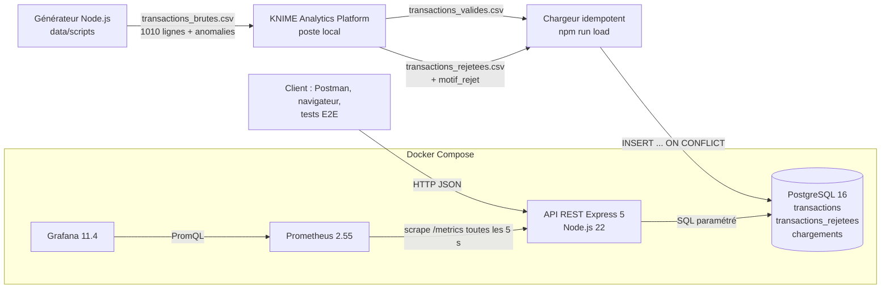
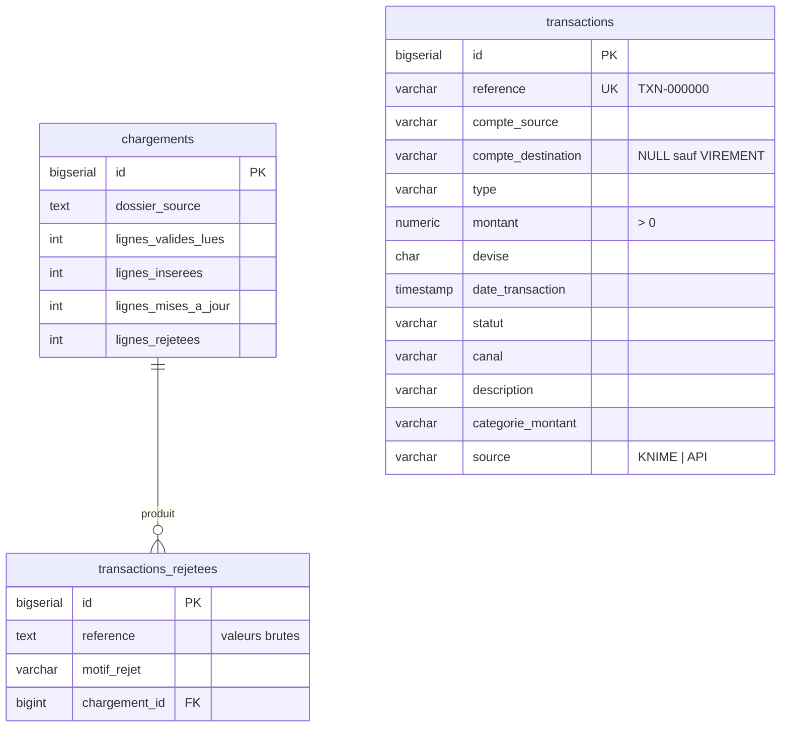

# Architecture

## 1. Vue d'ensemble



KNIME est une application de bureau : il tourne **hors Docker**, sur le poste de la personne chargée de l'ETL.
Le dossier `data/` est partagé : KNIME y écrit, le conteneur `api` le lit (monté en lecture seule sur `/data`).

## 2. Composants et choix techniques

| Composant | Technologie | Rôle | Justification |
|---|---|---|---|
| Générateur | Node.js (sans dépendance) | données bancaires fictives + anomalies contrôlées | déterministe (graine 2026) : toute l'équipe a les mêmes données ; manifeste des anomalies pour vérifier KNIME |
| ETL | **KNIME** (exigé) | normaliser, contrôler, dédoublonner, enrichir | outil demandé ; workflow visuel facile à présenter |
| Oracle ETL | Node.js (`reference-etl.js`) | résultat attendu des règles KNIME | permet de **prouver** que la sortie KNIME est correcte |
| Base | PostgreSQL 16 | stockage | contraintes CHECK = 2e barrière de validation ; index pour les filtres ; transactions SQL pour un chargement tout-ou-rien |
| API | **Express.js 5** (exigé) + `pg` | REST, filtres, pagination | Express 5 transmet les erreurs `async` au gestionnaire d'erreurs ; requêtes paramétrées |
| Métriques | `prom-client` 15 | `/metrics` | bibliothèque de référence pour Node.js |
| Collecte | **Prometheus** (exigé) | historique des métriques, alertes | modèle *pull* : l'API n'a pas besoin de connaître Prometheus |
| Visualisation | **Grafana** (exigé) | tableau de bord | provisionné par fichiers : rien à cliquer, installation reproductible |
| Tests | Jest + Supertest, `node:test`, Newman | unitaires, API, intégration, bout en bout | pas d'interface web fournie → outils de test d'API (exigence 6) |

## 3. Organisation du code de l'API (`api/src`)

```
server.js            démarrage, arrêt propre (SIGTERM)
app.js               assemblage Express (injection du dépôt de données)
config.js            variables d'environnement
domain/rules.js      règles métier (énumérations, formats, catégories)
validation/          validation des corps (POST/PATCH) et des paramètres de requête
repositories/        accès PostgreSQL (queryBuilder = SQL paramétré + liste blanche de tri)
routes/              transactions, rejets, chargements
metrics/metrics.js   compteurs, histogramme, middleware de mesure
middleware/          gestion centralisée des erreurs (400/404/409/503/500)
scripts/load-csv.js  chargement des sorties KNIME
```

Principe : les routes ne parlent qu'à une **interface de dépôt**. En production c'est PostgreSQL ;
dans les tests, un dépôt en mémoire de même interface. On teste ainsi le HTTP sans base, puis le SQL
séparément (tests d'intégration).

## 4. Modèle de données



## 5. Qualité des données : trois barrières

1. **KNIME** : règles métier complètes, motif de rejet explicite pour chaque ligne refusée.
2. **Chargeur** : revalide chaque ligne « valide » avec les règles de l'API (`REJET_CHARGEMENT` si incohérence).
3. **PostgreSQL** : contraintes `CHECK`, `UNIQUE`, `NOT NULL` ; même un `INSERT` manuel invalide est refusé.

## 6. Idempotence et doublons

- Doublons **dans le fichier** : KNIME garde la 1re occurrence d'une référence, rejette les suivantes (`DOUBLON_REFERENCE`).
- **Rechargement** : `INSERT … ON CONFLICT (reference) DO UPDATE` → relancer le chargement ne crée aucun doublon (testé).
- Une transaction créée par l'API (`source = API`) n'est jamais écrasée par un rechargement KNIME (testé).
- Doublon via l'API : `POST` d'une référence existante → **409 CONFLIT**.

## 7. Supervision

```
Express ─ middleware ─▶ compteurs / histogramme (mémoire) ─▶ GET /metrics
Prometheus ─ toutes les 5 s ─▶ GET api:3000/metrics ─▶ base temporelle (7 jours)
Grafana ─ PromQL ─▶ Prometheus ─▶ 13 panneaux (disponibilité, débit, taux d'erreurs, p50/p95/p99, ...)
```

Requêtes PromQL clés :
- débit : `sum(rate(http_requests_total{job="api-transactions"}[1m]))`
- taux d'erreurs : `sum(rate(http_request_errors_total[5m])) / sum(rate(http_requests_total[5m]))`
- latence p95 : `histogram_quantile(0.95, sum by (le) (rate(http_request_duration_seconds_bucket[5m])))`

Trois règles d'alerte (`monitoring/prometheus/alert_rules.yml`) : API indisponible, taux d'erreurs 5xx > 5 %, p95 > 500 ms.

## 8. Ports

| Service | URL sur le poste | Dans le réseau Docker |
|---|---|---|
| API | http://localhost:3000 | `api:3000` |
| PostgreSQL | localhost:5432 | `postgres:5432` |
| Prometheus | http://localhost:9090 | `prometheus:9090` |
| Grafana | http://localhost:3001 | `grafana:3000` |

Modifiables dans `.env` (`*_HOST_PORT`) si un port est déjà occupé.
